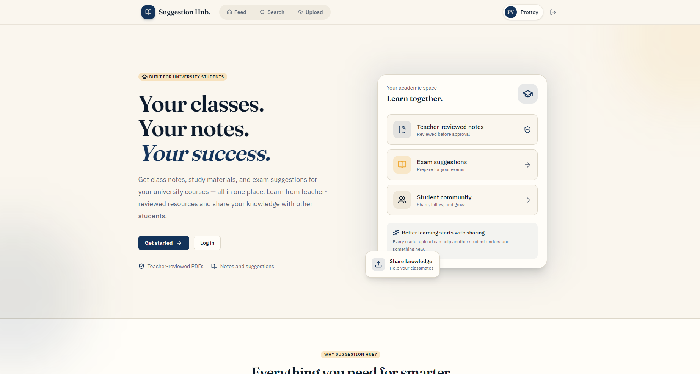
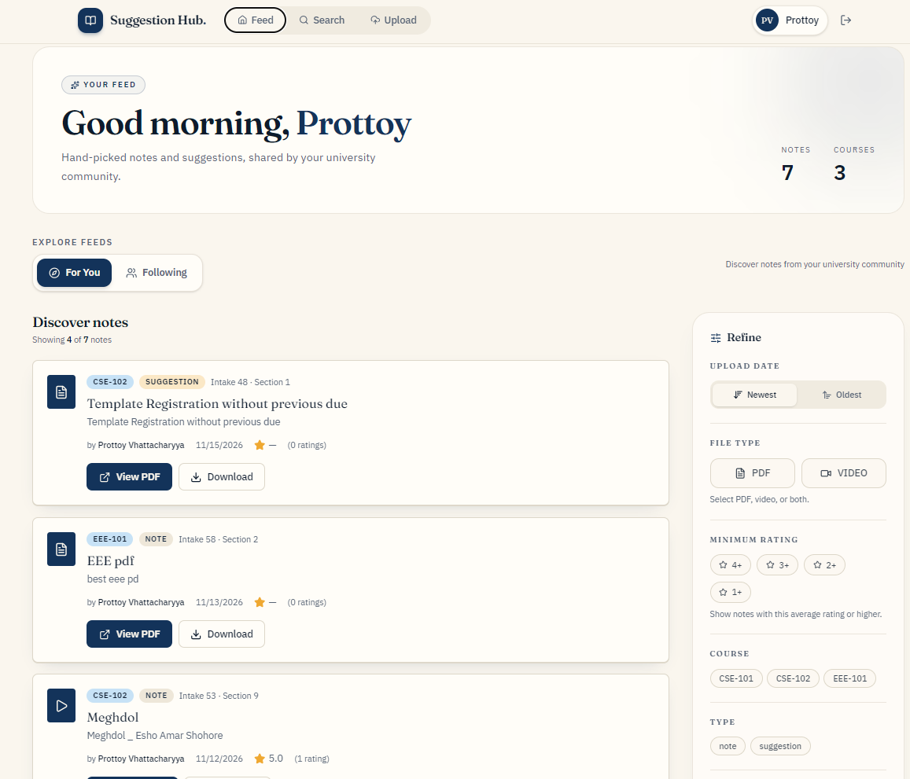
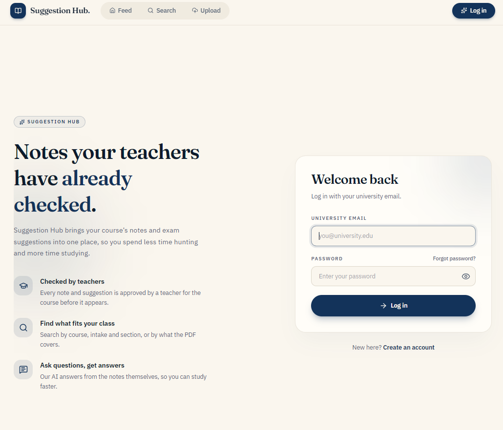
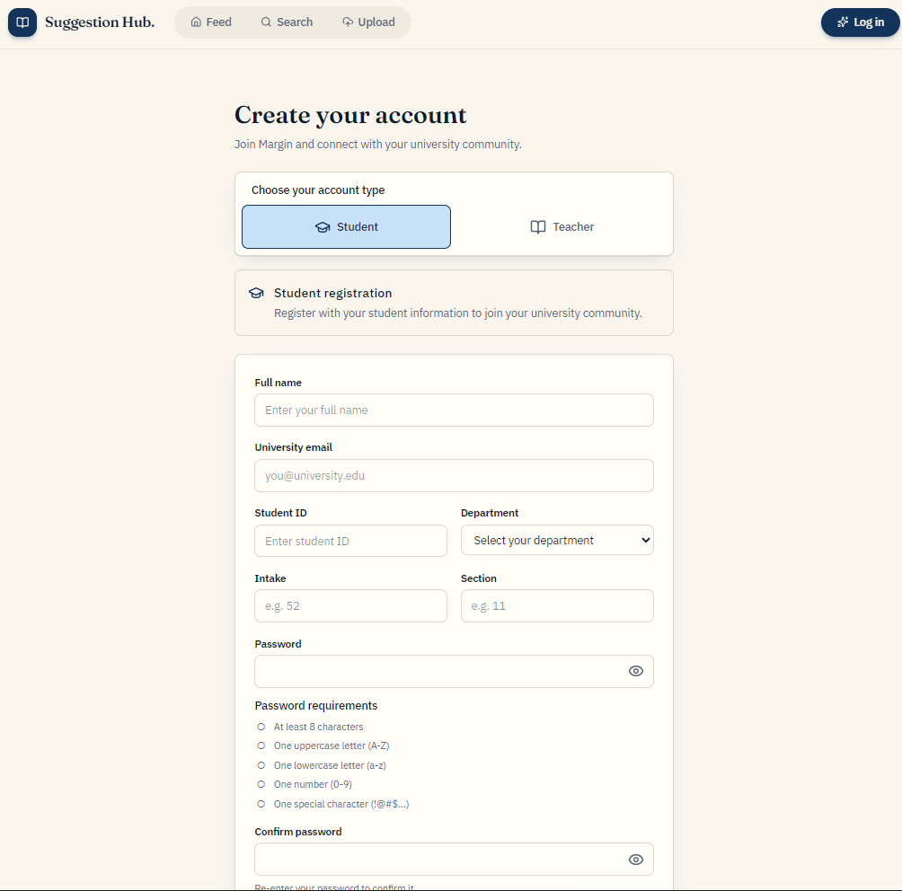
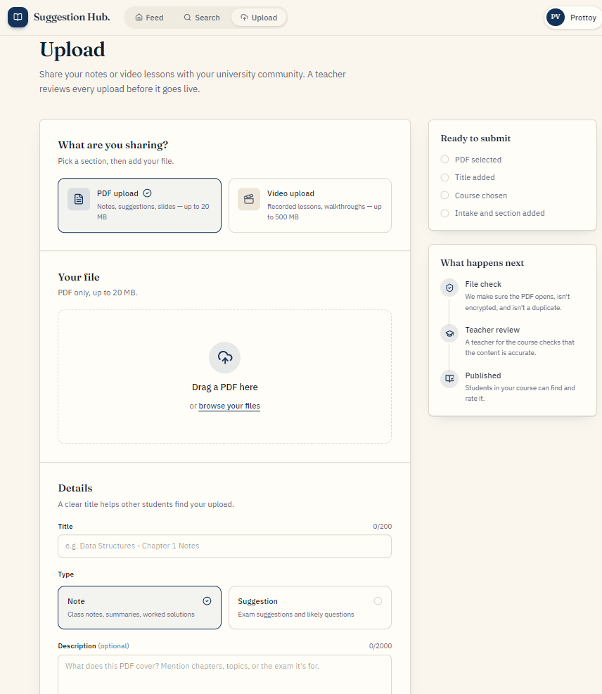
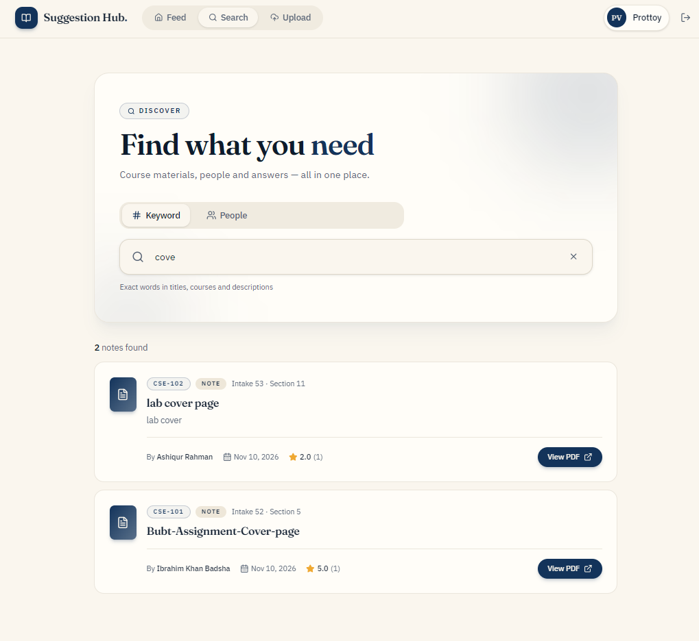
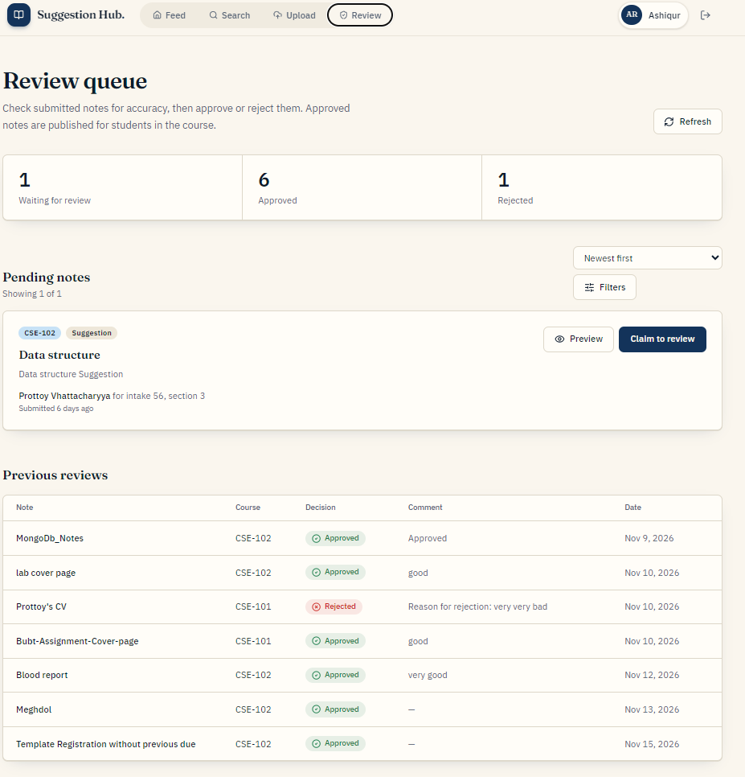
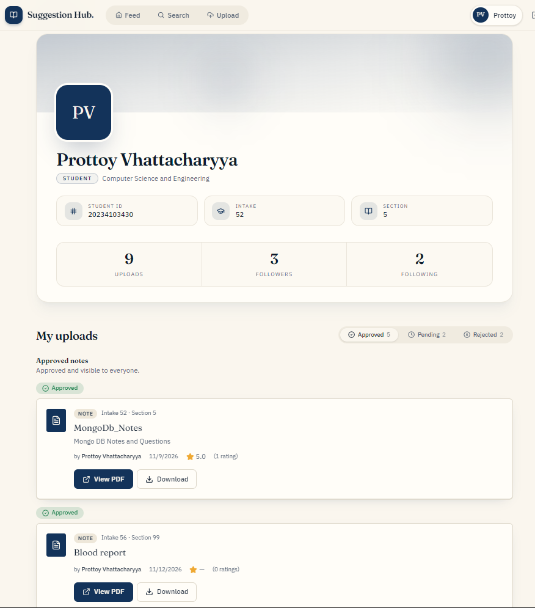
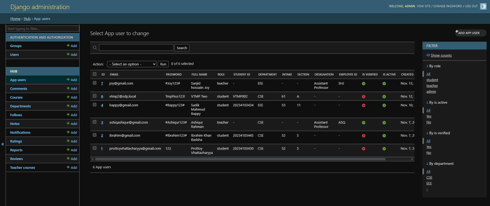

# Suggestion Hub — Notes & Suggestions Sharing Platform

A university-focused platform for sharing, reviewing, and discussing course
notes. Students and teachers can sign up, upload notes, review them, browse
feeds, and search — with an admin panel for moderation.

## Live URLs

| App     | URL                                        |
| ------- | ------------------------------------------ |
| Frontend | [https://suggestion-hub.prottoy.qzz.io/](https://suggestion-hub.prottoy.qzz.io/) |
| Admin    | [https://admin.prottoy.qzz.io/](https://admin.prottoy.qzz.io/) |

## Installation & Running (Docker — recommended)

Requires [Docker](https://www.docker.com/) only.

```bash
# 1. Clone the repository
git clone https://github.com/prottoy-bhattacharyya/Suggestion-Hub.git
cd Suggestion-Hub

# 2. Start everything (backend + frontend + MySQL)
docker compose up --build
```

Then open:

- Frontend: **http://localhost:8081**
- Django admin: **http://localhost:8000/admin** (login: `admin` / `admin`)

Stop the app:

```bash
docker compose down        # keeps database data
docker compose down -v     # also wipes the database
```

## Installation & Running (Manual)

Requires Node.js, Python 3.13 + [uv](https://docs.astral.sh/uv/), and MySQL.

```bash
# 1. Create the MySQL database (run once in a MySQL client)
#    CREATE DATABASE suggestion_hub;

# 2. Backend — terminal 1
cd backend
uv sync
uv run python manage.py migrate
uv run python manage.py runserver

# 3. Frontend — terminal 2
cd frontend
npm install
npm run dev
```

Then open **http://localhost:8081** in your browser.

> Database credentials are configured in `backend/core/utils.py`
> (`get_db_connection()`). Edit that file if your MySQL settings differ.
## Screenshots

### Home


### Feeds


### Login & Signup



### Upload Notes


### Search


### Teacher Review


### Profile


### Admin Panel


